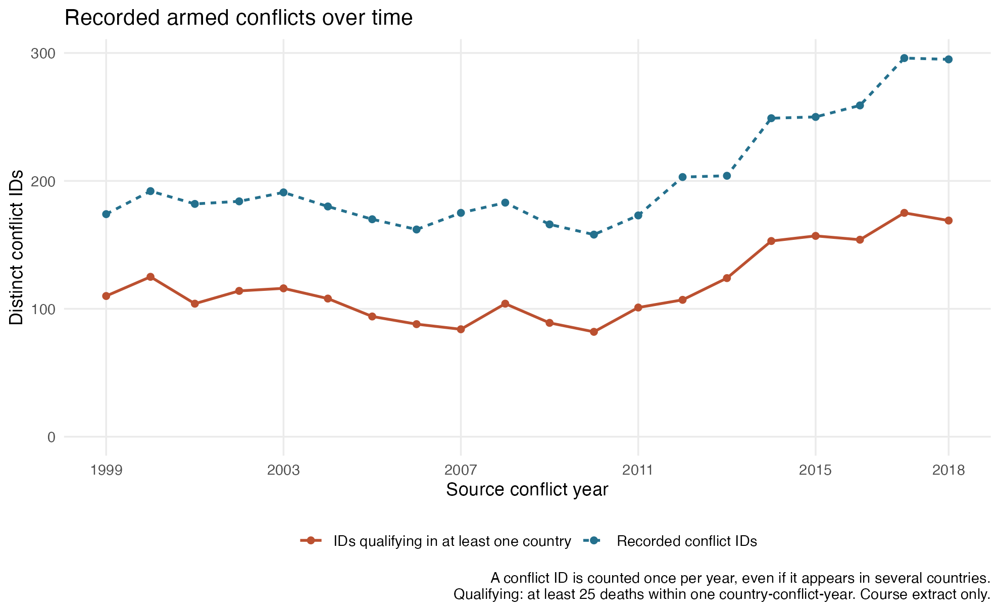
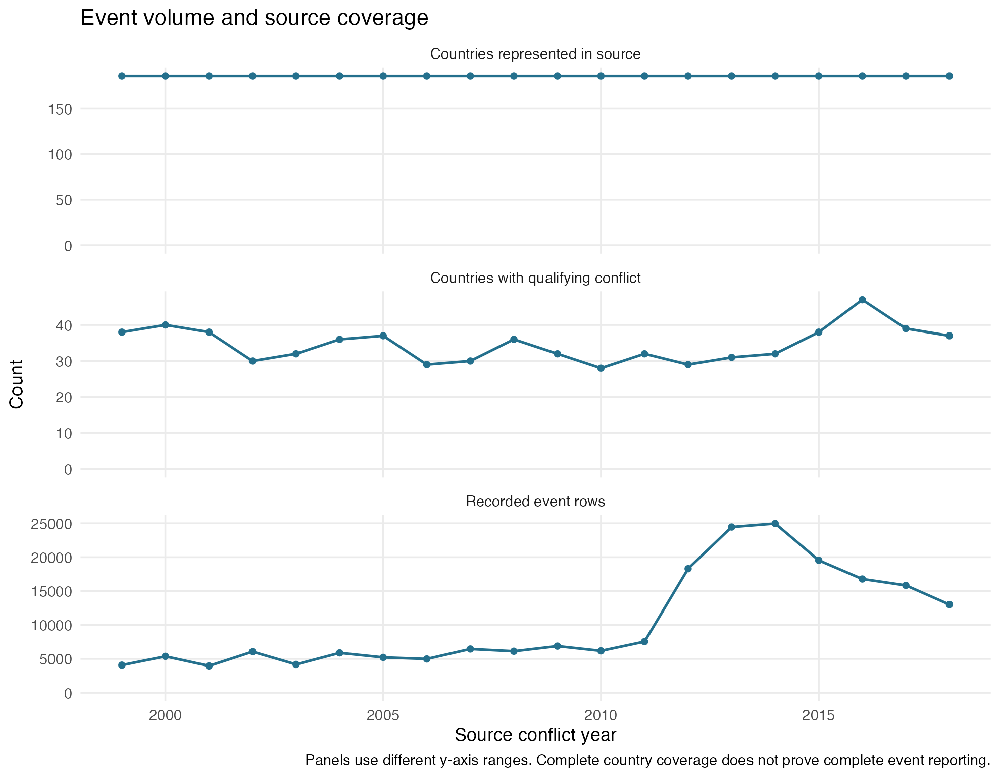
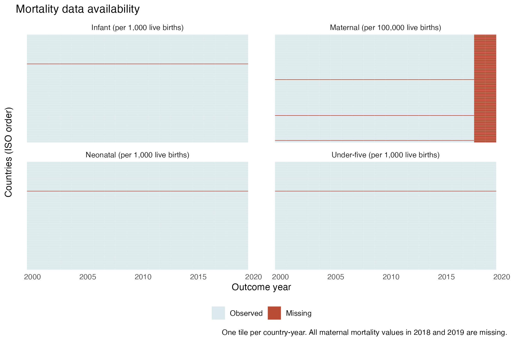
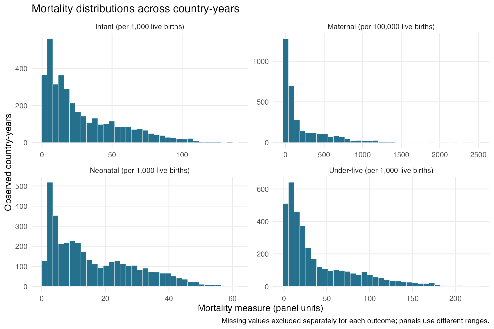
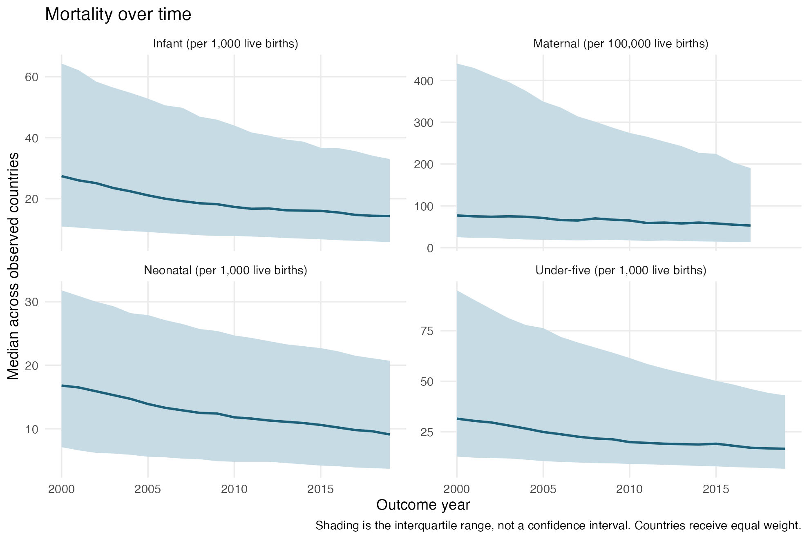
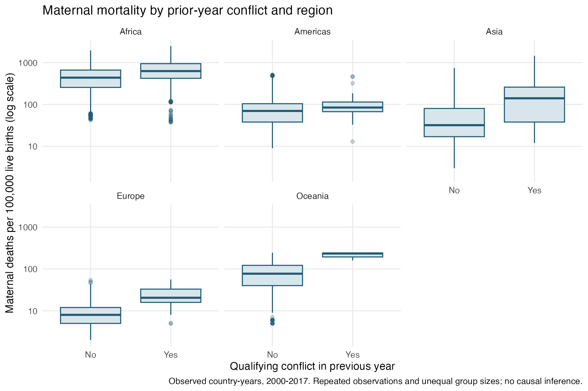

```{r}
read_table <- function(name) read.csv(file.path("tables", name), check.names = FALSE)
annual <- read_table("annual_conflict_counts.csv")
audit <- read_table("data_audit.csv")
missing <- read_table("missingness.csv")
summary <- read_table("continuous_summary.csv")
trends <- read_table("mortality_time_trends.csv")
by_conflict <- read_table("mortality_by_conflict.csv")
by_region <- read_table("region_summary.csv")
stopifnot(all(read_table("eda_checks.csv")$passed))
```

## Starting question and observation units

The quiz plan was to examine changes in recorded armed conflicts over time,
after checking the meaning of a row, missing data, and repeated records. That
question guides the first part of this analysis. The remaining sections examine
mortality distributions, missingness, and differences across regions and
prior-year conflict groups to prepare for descriptive tables and later models.

The raw conflict file has event-level records for **1999-2018**, including
explicit no-event country-year placeholders. The final dataset has one row per
**country and outcome year**, with 186 countries over 2000-2019. Its conflict
variable refers to the previous year. The two time axes therefore differ by
one year; there is no contemporaneous 2019 conflict count in these files.

A conflict may have several event rows and occur in more than one country.
The main trend counts each distinct `conflict_id` once per source year. A second
series counts IDs that reach at least 25 deaths within at least one
country-conflict-year. Neither series is a count of new conflict onsets.

## Data checks before counting

```{r}
knitr::kable(audit, col.names = c("Check", "Count"), format.args = list(big.mark = ","))
```

There are `r format(audit$count[audit$item == "Repeated rows across all supplied fields"], big.mark = ",")`
rows whose available fields repeat an earlier row. The extract has only
`conflict_id`, `iso`, `year`, and `best`; it has no unique event ID, date, or
location identifier. Identical reduced rows can represent different events,
so they were not removed. This limits what can be concluded about event counts
and death totals without the fuller source data.

Every source year contains 186 country codes. No country/year key is missing,
and all real events have death counts. The final dataset has no duplicate
country-year keys. The [comparison report](compare_final_data.html) records 32
passed checks and exact agreement with the two archived Week 3 outputs.

## How recorded conflicts change over time

{fig-alt="Annual counts of distinct recorded and qualifying conflict IDs, 1999 to 2018."}

Recorded IDs number **`r annual$recorded_conflicts[annual$year == 1999]` in 1999**
and **`r annual$recorded_conflicts[annual$year == 2018]` in 2018**. The lowest
count is `r min(annual$recorded_conflicts)` in
`r annual$year[which.min(annual$recorded_conflicts)]`; the highest is
`r max(annual$recorded_conflicts)` in
`r annual$year[which.max(annual$recorded_conflicts)]`. The pattern is not a
steady rise: the series falls through much of the 2000s before increasing in
the 2010s. The qualifying-conflict count is lower because some recorded IDs do
not reach the threshold within any one country-year.

{fig-alt="Annual event rows, countries with qualifying conflict, and source-country coverage in separate panels."}

Event rows rise from `r annual$event_records[annual$year == 2011]` in 2011 to
`r annual$event_records[annual$year == 2012]` in 2012, then peak at
`r max(annual$event_records)` in `r annual$year[which.max(annual$event_records)]`.
The number of countries with qualifying conflict peaks in
`r annual$year[which.max(annual$countries_with_conflict)]`, a different year.
Conflict IDs, event records, and affected countries measure different aspects
of the data. Stable country coverage does not rule out changes in reporting
intensity or coding. This extract alone cannot explain the jump in event rows.

```{r}
knitr::kable(annual[c("year", "recorded_conflicts", "qualifying_conflicts",
                    "event_records", "countries_with_conflict")],
  col.names = c("Source year", "Recorded IDs", "Qualifying IDs", "Event rows", "Affected countries"))
```

## Missing mortality and covariate data

{fig-alt="Missingness map by country and year for four mortality outcomes."}

```{r}
knitr::kable(missing[missing$missing_n > 0, ],
  col.names = c("Variable", "Missing rows", "Missing (%)"), digits = 2)
```

All maternal mortality values in 2018 and 2019 are absent. Those two years
account for 372 of the 426 missing maternal observations; 54 are missing earlier.
The other mortality measures each have 20 missing observations. Available-case
summaries are calculated separately for each variable. Missing values are not
imputed, and rows are not removed merely because another variable is missing.
A later model needs an explicit outcome-specific sample definition.

## Distributions and unusual values

{fig-alt="Histograms of four mortality measures among observed country-years."}

Maternal mortality has a median of `r summary$median[summary$variable == "maternal_mortality"]`
and a mean of `r round(summary$mean[summary$variable == "maternal_mortality"], 1)`
per 100,000 live births, with a long upper tail. The maximum is
`r summary$max[summary$variable == "maternal_mortality"]`. These high values are
retained: they match the source file, and an extreme value alone is not evidence
of a coding error. The child mortality outcomes are also right-skewed.

```{r}
knitr::kable(summary[c("variable", "observed_n", "median", "q1", "q3", "min", "max")],
  col.names = c("Variable", "Observed N", "Median", "Q1", "Q3", "Minimum", "Maximum"), digits = 2)
```

All observed mortality values are nonnegative, and neonatal mortality does not
exceed infant mortality, which does not exceed under-five mortality. No observed
numeric value is infinite. GDP and the other covariates remain in their supplied
scales; their full unit definitions should be confirmed before interpretation.
The complete summaries also include means and standard deviations in
[continuous_summary.csv](tables/continuous_summary.csv).

## Mortality over time

{fig-alt="Annual medians and interquartile ranges for four mortality measures."}

Median mortality declines over the available years for all four outcomes.
The maternal series ends in 2017 because the later values are missing. Shading
shows variation across countries, not uncertainty around an estimated mean.
These are unweighted country summaries. They do not estimate a birth-weighted
world mortality rate, and available-country counts are saved alongside each
annual summary.

## Conflict exposure and region

```{r}
knitr::kable(by_region, col.names = c("Region", "Countries", "Country-years",
  "Prior-conflict years", "Prior conflict (%)", "Maternal observed N", "Maternal median"), digits = 1)
```

Africa and Asia contribute most exposed country-years. Oceania contributes only
three, so its exposed group is too small for a stable descriptive comparison.
Country counts and country-year counts must not be used interchangeably.

{fig-alt="Regional boxplots of maternal mortality by prior-year conflict status on a log scale."}

Across all observed maternal country-years, the median is
`r by_conflict$median[by_conflict$outcome == "maternal_mortality" & by_conflict$armed_conflict_lag1 == 1]`
in the prior-conflict group and
`r by_conflict$median[by_conflict$outcome == "maternal_mortality" & by_conflict$armed_conflict_lag1 == 0]`
in the no-prior-conflict group, per 100,000 live births. The groups differ in
geography, calendar time, and other characteristics. Observations from the same
country are correlated. These descriptive differences do not identify an effect
of conflict, and no independent-observation significance tests are used here.

## What this suggests for the next analysis

Use country-year as the observation unit, label the one-year conflict lag, and
report missing counts with each measure. Limit maternal trend displays to years
with observed data. For later regression, define the sample by outcome and
account for repeated measurements within countries, time trends, and the study's
confounding assumptions. Before interpreting the increase in event rows, seek
source documentation on reporting and event identifiers.

The raw data and Week 3 outputs were not corrected because the comparison found
no discrepancies. No causal model is fitted in this EDA.
